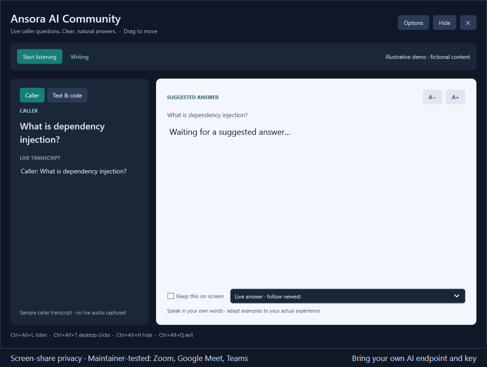

# Ansora AI Community

**Live caller transcription, concise answer suggestions, and resume-aware coding help for Windows.**

[](LICENSE)
[](https://github.com/govindpokuri/ansora-ai/actions/workflows/ci.yml)
[](https://github.com/govindpokuri/ansora-ai/releases/tag/v0.1.14-community.1)

**[Download the Windows portable preview](https://github.com/govindpokuri/ansora-ai/releases/download/v0.1.14-community.1/AnsoraAI-Community-0.1.14-community.1-win-x64.zip)** ·
[Setup guide](docs/WINDOWS_QUICKSTART.md) · [How it works](docs/TECHNICAL_WALKTHROUGH.md) ·
[Contribute](CONTRIBUTING.md) · [Donate](https://razorpay.me/@ansoraai)

Bring your own chat-completions endpoint and API credentials, or self-host the
optional PHP backend. No hosted Ansora purchase is required for direct mode.
AI provider charges still apply. This repository contains no API keys, customer
data, speech-model weights, or prebuilt commercial installers.

## See the app



*Illustrative demo rendered from the real WPF interface using fictional content.
It is not a live call recording or a response-time benchmark.*

[Full-resolution answer screenshot](docs/assets/app-answer.png) ·
[Coding screenshot](docs/assets/app-code.png)

## Try the Windows preview — no SDK required

Download and verify the [portable ZIP and SHA-256 checksum](https://github.com/govindpokuri/ansora-ai/releases/tag/v0.1.14-community.1),
extract the complete folder, and run `Start.cmd`. Setup asks for your AI endpoint,
model and hidden API key, then downloads/checks the English speech model separately
(about 148 MB). The ZIP includes .NET; Microsoft Visual C++ x64 may still be needed.
Windows 11 x64 is the tested target. This is an **unsigned Community preview**.
See the [first-run guide and troubleshooting](docs/WINDOWS_QUICKSTART.md).

## Features

- Local English transcription of selected speaker/headphone output with Whisper.
- Automatic streaming answer suggestions next to the caller's question.
- Pasted questions and coding problems.
- PDF, DOCX or text resume analysis with a reviewed experience/language profile.
- Movable, resizable overlay with adjustable background opacity and shortcuts.
- **Screen-share privacy:** keeps the overlay out of supported Windows captures.
  **Maintainer-tested with Zoom, Google Meet and Microsoft Teams.** See the
  [compatibility notes](docs/SCREEN_SHARE_PRIVACY.md) and verify your sharing mode.
- Local call references and HTML/JSON exports with token usage.

Use it for practice, accessibility and conversations where assistance is permitted.
Obtain appropriate consent before transcribing others. AI and speech recognition
can make mistakes. Screen-capture exclusion is best-effort, not undetectability.

## Quick start: bring your own AI endpoint

1. Install Git, the **.NET 9 SDK** (the current source target), and Microsoft's
   Visual C++ x64 runtime. Windows 11 x64 is the supported development target.
2. Clone and download the English Whisper model (about 148 MB, checksum verified):

   ```powershell
   git clone https://github.com/govindpokuri/ansora-ai.git
   cd ansora-ai
   ./download-model.ps1
   ```

3. Start the Community launcher:

   ```powershell
   ./run-community.ps1
   ```

   Supply your full HTTPS chat-completions URL, deployment/model, authentication
   type (`Bearer` or `api-key`), and API key at the hidden prompt. The key is
   passed to the launched process and stored using Windows DPAPI for your user;
   it is not written into JSON configuration.
4. In **Options > Settings**, choose the speakers/headphones used by your call.
   Play audio or join a permitted call, then select **Start listening**.
5. Optionally upload a resume, review its summary and languages, then select
   **Use this profile**. Use the pasted-question tab for text/coding problems.

For ordinary `dotnet run`, configure `OverlayCopilot/settings.defaults.json`
with your endpoint/model/auth and supply `OVERLAYCOPILOT_AI_KEY` to the process.
Never commit a key or put it in a command saved in shell history. The launcher
is the recommended approach.

## Build and test

```powershell
dotnet build OverlayCopilot/OverlayCopilot.csproj -c Release
dotnet run --project OverlayCopilot.Tests/OverlayCopilot.Tests.csproj -c Release
```

Tests use an executable Windows/WPF regression harness, not `dotnet test`.
Some optional audio/provider/interactive modes need additional prerequisites.
Use mock providers and fictional profiles; never production accounts or keys.

Create a self-contained build:

```powershell
dotnet publish OverlayCopilot/OverlayCopilot.csproj -c Release -r win-x64 --self-contained true -o artifacts/community-win-x64
```

Run `AnsoraAI.exe` from that directory with its supporting files. Keep
`models/ggml-base.en.bin` in the repository or in a models folder beside the
executable. Community settings use `%LOCALAPPDATA%/AnsoraAICommunity`, separate
from an installed paid app's configuration.

## Optional backend and website

`commercial/` contains the PHP/MySQL service: email OTP, account administration,
token wallets/usage, Razorpay verification/webhooks, and the AI proxy/failover.
Its historical folder name does not change its MIT license. Direct desktop
use does not require the backend or a token purchase.

Read [self-hosting](docs/SELF_HOSTING.md), [configuration](docs/CONFIGURATION.md),
[architecture](docs/ARCHITECTURE.md), and [releases](docs/RELEASING.md).
Replace the example website's domain, offer, prices, policies, support/business
details and promotional content before deployment.

## Help improve Ansora

Looking for a first contribution? Browse [good first issues](https://github.com/govindpokuri/ansora-ai/issues?q=is%3Aissue%20is%3Aopen%20label%3A%22good%20first%20issue%22)
or [help wanted](https://github.com/govindpokuri/ansora-ai/issues?q=is%3Aissue%20is%3Aopen%20label%3A%22help%20wanted%22).
Useful areas include first-run audio guidance, keyboard accessibility, reproducible
transcription examples, and provider compatibility. Please use fictional or
consented/generated data, and include the relevant environment and validation.

## Privacy

Local speech mode processes audio on your computer. Questions, context and
resume text used for AI requests go to the configured provider/backend.
Provider retention policies apply. Keys/profiles use Windows DPAPI; this does
not protect against malware running as your user. Calls may be autosaved in
`Documents/Ansora AI Community/Calls`, including sensitive transcript/answer/request
context. Review and delete those files when appropriate. Never post real calls,
resumes, credentials or customer records in issues.

## Support / donate

Enjoy using Ansora AI? [Donate through Razorpay](https://razorpay.me/@ansoraai)
or use the **Sponsor** button on GitHub. Donations are optional and do not unlock
features, buy hosted tokens, or guarantee support. Stars, useful bug reports,
documentation and code contributions are welcome too. See [SUPPORT.md](SUPPORT.md).

## Contributing, security and license

See [CONTRIBUTING.md](CONTRIBUTING.md) and [SECURITY.md](SECURITY.md).
Original project code is [MIT licensed](LICENSE). Third-party components retain
their own licenses; preserve [third-party notices](THIRD_PARTY_NOTICES.md).
