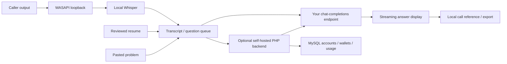

# Architecture

Desktop: C# WPF, .NET 9, NAudio, Whisper.net, PdfPig and Windows DPAPI.
The existing OverlayCopilot namespace is retained to limit unnecessary churn;
the Community binary is AnsoraAI.exe with isolated Community settings.

Backend: PHP 8.3+, PDO MySQL, cURL, SSE, email adapters, HMAC payment validation,
and transactional token reservations. Authentication and wallet enforcement
remain server-side even when a client can be modified.

Direct mode requires no hosted account/purchase; provider charges still apply.
Hosted mode authenticates against the operator's service and balance. Source
access grants no access to another operator's credentials or hosted capacity.
