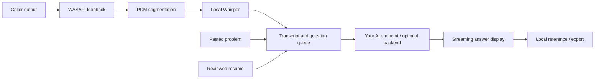

# Building a Windows AI interview assistant with C#, Whisper, and streaming responses

Ansora AI Community brings a caller's words and a suggested answer into one
Windows window. The open-source edition is a C# WPF application with local
English transcription and a configurable chat-completions endpoint. The code is
MIT licensed; users supply their own AI access. The optional PHP/MySQL backend
adds accounts, usage accounting, mail and billing for self-hosted operators.

## The useful path through the product

A caller speaks through the selected speakers/headphones. Ansora captures that
output with WASAPI loopback, turns it into speech-recognition segments, and uses
Whisper.net to recognise the words locally. A queue decides when a question is
ready for an AI request. Incoming answer chunks are displayed while the response
is still streaming. A pasted problem can take a separate path into the same
answer display. The README demo shows real controls with synthetic content; it
does not measure recognition latency or accuracy.

## Why audio-device selection matters

Loopback captures output, not everything happening in a meeting. If the caller
is playing through headphones but another device is selected, the recogniser
will not receive that caller. Speaking into a microphone alone is not a useful
caller-only test. Headphone routing, device changes, overlapping speech and quiet
audio are practical areas where clear setup guidance matters as much as code.

The speech pipeline uses bounded segments and cancellation. Longer unbounded
audio buffers delay useful results and complicate shutdown. Recognition is
fallible: accents, noise and overlapping speakers still need careful evaluation
with consented or generated examples. No universal accuracy figure is claimed.

## Keeping the window responsive

Audio capture, inference and HTTP streaming have different lifetimes. The app
uses queues, cancellation and buffered display updates rather than rebuilding
the whole answer document for each token. Answer history and keeping an answer
on screen need explicit behavior so a new caller question is not accidentally
confused with a held answer. These are state-management problems, not just prompt
changes. The regression harness exercises segmentation, streaming and presentation.

## Resume context and coding

The app can extract text from PDF, DOCX or TXT resumes. A user reviews the
resulting profile before it becomes context. Coding instructions use confirmed
languages, and prompts tell the model not to invent experience. This reduces
unhelpful assumptions but does not guarantee factual answers. Scanned PDFs may
need OCR elsewhere. Extracted resume text sent for analysis is provider data;
local transcription does not make the whole workflow offline.

## Credentials and data boundaries

The Community launcher accepts an API key through a hidden prompt. The app
consumes the process variable and stores the key with Windows DPAPI for the
current user. That avoids a key in source/default JSON; it does not protect
against malware running as that user. The Community settings/profile directory
is separate from the paid installation. Call exports may contain sensitive
conversation and request context, so screenshots and test fixtures use fictional
data. A self-hosted backend keeps account and wallet enforcement on the server.

## Screen-share privacy

The window requests Windows capture exclusion through `SetWindowDisplayAffinity`
and checks whether the setting was applied. The maintainer reports successful
tests with Zoom, Google Meet and Microsoft Teams. This is a useful privacy
feature, but an OS setting is not a promise about every capture path or version.
The [screen-share notes](SCREEN_SHARE_PRIVACY.md) explain how to verify the exact
sharing mode without treating a local status message as proof of the remote view.

## What the repository includes

The repository contains the desktop, an executable Windows regression harness,
backend source/tests, setup documentation and a Community release builder. Speech
weights are downloaded separately with a checksum. The portable preview includes
.NET but may still need Microsoft's Visual C++ runtime. Native Windows and device
compatibility still need testing on other machines. The initial Community work
passed 148 desktop checks and 26 PHP output-limit checks locally; these are test
counts, not performance or accuracy claims.

## Good next contributions

- A clearer first-run device guide for headphones and meeting applications.
- Keyboard/accessibility checks for the caller and pasted-question flows.
- Consent-safe reproducible audio fixtures covering difficult recognition cases.
- Provider examples with explicit authentication and streaming expectations.

Try the [Windows preview](WINDOWS_QUICKSTART.md), inspect the [architecture](ARCHITECTURE.md),
or choose an issue in [the repository](https://github.com/govindpokuri/ansora-ai/issues).
Use the tool for practice, accessibility and conversations where assistance is
permitted, and review generated answers before relying on them.
